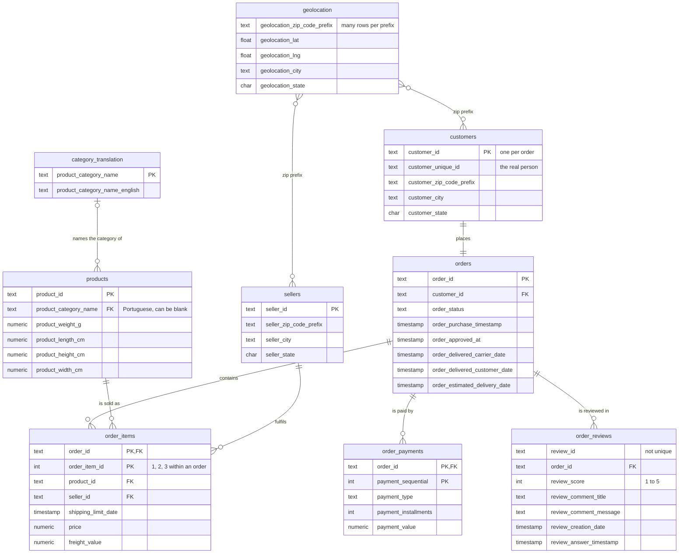
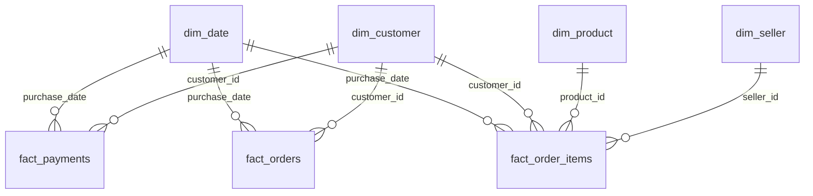

# Data model

How the 9 Olist tables relate to each other. GitHub draws the diagram from the Mermaid code below. The counts come from the full dataset (99,441 orders).

`products` also has three descriptive columns left out of the diagram: `product_name_lenght`, `product_description_lenght` and `product_photos_qty` (the misspellings come from the source files).

**Reading the lines:** `||` means exactly one, `|o` zero or one, `o{` zero or many, `}o` many. For example, `orders ||--o{ order_items` means each order has zero or more items and each item belongs to exactly one order.

## The centre of the model: orders and order_items

`orders` is the hub. Every other table joins to it directly or through `order_items`.

| Relationship | Join on | In the data |
|---|---|---|
| order → items | `order_id` | 0 to 21 items per order. 775 orders have none (mostly unavailable or canceled). |
| item → product | `product_id` | Every product has been sold at least once. |
| item → seller | `seller_id` | One order can include items from up to 5 sellers. |
| order → payments | `order_id` | 1 to 29 payment rows per order (e.g. voucher + card). 1 order has none. |
| order → reviews | `order_id` | 98,673 orders have a review and 768 don't. Up to 3 reviews per order. |
| order → customer | `customer_id` | Exactly one order per `customer_id`. |

## Traps to avoid when joining

- **`customer_id` is not the customer.** Olist creates a new `customer_id` for every order, so the join to `orders` is one-to-one. To follow a real person across orders, use `customer_unique_id` (one person placed up to 17 orders).
- **Joining items multiplies rows.** `order_items` has one row per item, so joining it to `orders` repeats each order once per item. Count orders with `COUNT(DISTINCT order_id)`, or aggregate items per order first.
- **Joining payments and items together double-counts both.** An order with 2 items and 2 payments becomes 4 rows. Aggregate each table to one row per order before joining them.
- **Reviews aren't unique.** `review_id` repeats and 547 orders have more than one review, so average scores per order before joining (as the analysis queries do).
- **The category translation is optional.** 610 products have no category and 2 categories have no English name. Use a `LEFT JOIN` to `category_translation` and `COALESCE` to fall back to the Portuguese name or `'unknown'`.
- **Geolocation has no key.** One zip prefix has many latitude/longitude rows, so joining it directly to customers or sellers multiplies rows. Reduce it to one row per prefix first (for example, the average latitude and longitude), then join on the zip prefix. This is why the schema has no foreign key to it.

## Where the keys are enforced

- **PostgreSQL** adds the primary keys in [`01_create_tables.sql`](../sql/postgres/01_create_tables.sql) and the foreign keys and indexes after loading, in [`03_add_constraints.sql`](../sql/postgres/03_add_constraints.sql). If any row broke a relationship, adding the foreign keys would fail.
- **SQLite** declares the keys in [`01_create_tables.sql`](../sql/sqlite/01_create_tables.sql), and the loader checks them with `PRAGMA foreign_key_check`.
- [`data_quality_checks.sql`](../sql/checks/data_quality_checks.sql) re-checks the joins on both databases (no orphan orders, items, products or sellers).

## The Power BI star schema

Power BI doesn't read the raw tables. It reads views from [`05_powerbi_views.sql`](../sql/postgres/05_powerbi_views.sql), in a separate `powerbi` schema, arranged as a star schema: three fact tables, each at a single grain, sharing four dimensions. Because items, payments and reviews each live in their own fact, or are rolled up to the order first, none of the join traps above can double-count.

| View | One row per | Used for |
|---|---|---|
| `fact_orders` | order (99,441) | delivery time, lateness, review score, order value |
| `fact_order_items` | item sold (112,650) | revenue by category, product and seller |
| `fact_payments` | payment (103,883) | payment types and instalments |
| `dim_date` | day, Sep 2016 – Oct 2018 | trends by month, quarter, weekday |
| `dim_customer` | `customer_id` | state, region, city, real person (`customer_unique_id`) |
| `dim_product` | product | English category, weight, volume |
| `dim_seller` | seller | state, region, short code for charts |

Every fact has `is_completed` (not canceled or unavailable) and `in_analysis_window` (Jan 2017 – Aug 2018) flags, so the dashboard can use the same filters as the SQL analysis. `is_late` is stored as 0 or 1, so averaging it gives the late rate. States are grouped into Brazil's five regions.
